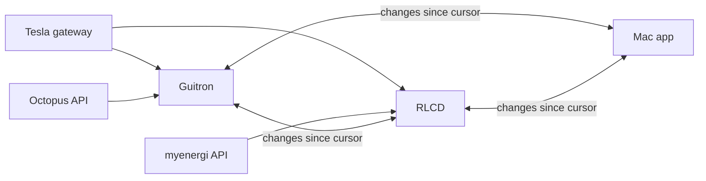

# The Store

How Bruce's Smart Home keeps its data in [bruce-db](https://github.com/bruceskingle/bruce-db), the record store it
shares with its capture devices. bruce-db's own design, the record model, IDs, the layout on disk, compaction and
replication, is in its [docs/design.md](https://github.com/bruceskingle/bruce-db/blob/main/docs/design.md); this is
what the app and the firmware do with it, and why. It was split out of that design on 13 November 2026.

## Why one store

Before 0.5.0 only the Octopus API caches used DataSet; every store added since the capture devices had its own code
and its own layout:

| Data | Where | Code | On disk | DataSet? |
| --- | --- | --- | --- | --- |
| Octopus API data: bills, measurements, telemetry, sessions, rates | App | `src/data_set/*` | One JSON file a set, locked, refresh and final rules | Yes |
| Tariff history | App | `src/octopus/meter_agreement.rs` | `<account>#TariffHistory`, JSON lines appended | No, hash-key name only |
| Tesla snapshots | App | `src/tesla/snapshot.rs` | JSON lines a day, own dedupe and "latest" | No |
| myenergi status | App | `src/myenergi/fetch.rs` | A file a poll, `#status-HHMMSS` | No |
| myenergi minute records | App | `src/myenergi/fetch.rs` | A day file, read, merged, rewritten | No |
| Octopus dispatches | App | `src/octopus/flex_poll.rs` | Own save-if-new | No |
| Temperature and humidity | App | `src/climate.rs` | `<profile>-climate/<device>/<series>/<date>.json` | No, its own layout |
| Poll log | App | `src/polling.rs` | `<profile>-polling/<date>.jsonl` | No |
| Captured records | Device | `capture/src/day_files.rs` | `/sd/capture/<feature>/<date>.jsonl`, appended, read by `since` | No |
| Start log | Device | bruce-esp-idf's `starts.rs` | NVS, the last 30 | No |

They drifted because DataSet was built as a cache of data an API can give again, and these are not: they are samples
taken once, from several devices, arriving late or out of order, some of them newer versions of a record already
kept, such as the open temperature period. The cost showed: the 1 November unpadded-day bug was in Tesla's copy of the
day-path code only, and "latest" was found by file modification time, which is wrong once devices write old records
after new ones. So everything the app and the devices keep, the API caches included, moves into one store, and the
whole profile replicates.

## Decisions of 6 November 2026

Made before the crate was built, with the move of the app's stores onto it:

- **A site belongs to a profile.** Each profile names its site, `Profile::site`, and two households, e.g. Bruce's and
  a friend's, are two sites. A redacted profile is a site of its own, made by copying with redaction. Every profile's
  site is in the data home's `store` directory, see `src/store.rs`.
- **The app's node** is 12 hex characters made at random once and kept in the settings, `node`, and its origin is
  `app-<node>`, which sorts after any device's ID of digits. A capture device's node and origin is its MAC address.
- **An API's reply is split into records, each item's JSON as the source sent it**, with a `#fetched` record saying
  what was asked for and when. Splitting is allowed; changing a value is not, see AGENTS.md's "Caches hold only what
  the source sent".
- **Files, e.g. a bill's PDF, go in the store's blobs.** A capture device does not keep them, see the device's store.
- **Secrets stay out of the store**: sessions, tokens and passwords stay in the profile and settings, so that they are
  not copied to every node, until bruce-db's Security Contexts can carry them.
- **IDs which are hashed**: account numbers, meter serials, MPANs, NMIs, Tesla gateway DINs and zappi serials. A
  capture device's ID stays readable.
- **Derived data**: what is cheap to work out, e.g. totals and checks, is worked out by whoever reads it, which also
  decides how it is shown, e.g. whether a difference from a bill is in the customer's favour. What is expensive, e.g.
  a bill's text read from its PDF, may be kept, in a kind of its own.
- **The existing profiles are converted, not fetched again**, into profiles renamed `_Old`, which only need to keep
  working; new profiles are made which fetch fresh data a little at a time, so that no conversion of data the app
  once changed, e.g. Octopus's meter readings, carries into them. The conversion is the profile upgrade to 0.5.0, see
  `src/convert.rs`, which converts the cache directory beside the store and bumps the profile's version last, so that
  one cut short is done again from the start.
- **The app reads only the store.** A build of the app from before the store was kept as a snapshot, so the app does
  not read both a device's old API and the store's feed: a device not yet moved to the store is not read until it is.

## Kinds

A DataSet's hash key is its site, its kind, then the rest. The kinds a capture device writes, and how each record
becomes an item, are in `src/device_kinds.rs`, which the firmware includes too, so that a device writes exactly the
items the app would when it polls a source itself:

| Kind | DataSet, after the kind | Sort key | Written by |
| --- | --- | --- | --- |
| `tesla.snapshot` | `gateway`, the site's one | the slot | every node that polls the gateway |
| `myenergi.status` | `hub`, the site's one | the slot | the owner of myenergi |
| `octopus.flex` | the account, hashed | the poll's time | the owner of Octopus |
| `climate.period` | the device's ID / series | the period's start | the device with the sensor |
| `device.info` | the device's ID | `-`, one record | the device |

The app's modules keep their own kinds beside them, e.g. `tesla.details`, `myenergi.minutes`, `octopus.tariff`,
`octopus.bills`, `octopus.measurementsconsumption`, the `globird.*` kinds and `app.poll`, each defined in its module.

Every device polls the Tesla gateway, and their snapshots of a slot differ a little, taken moments apart, so a slot is
one record: its version is the slot, and of equal versions the lowest device ID wins, the same on every node. If that
device misses a slot, another's reading fills it, which is sound, as the totals are the gateway's own. The app's own
version of a sampled record is a microsecond newer than a device's of the same second, so that it wins, as it has more
in it.

### DataSet on the store

A DataSet becomes its records, in the store, and its flavour's rules, in the app, for when to fetch again and what is
final:

| App's flavour | bruce-db's flavour |
| --- | --- |
| `SingleRecordDataSet`, e.g. the account | single record |
| `ListDataSet`, `MultiQueryDataSet` | list |
| `OrderedListDataSet`, the bills | ordered list; an open bill the server replaced is a tombstone |
| `MonthlyDataSet`, `MonthlyFixedSlotDataSet`, e.g. consumption | fetched series |
| Tesla, myenergi, dispatches, climate | captured series |

- **The rules stay**: `refresh_after`, what is final, fetching from the first record not final, `MIN_CACHED_RUN`;
  they read what is cached by a query rather than by loading a file.
- **The storage goes**: the JSON file a set, its lock and its modification time give way to records, a lock on the
  hash key, and the `#fetched` records, so that the API caches replicate like everything else.
- **Fetching again is a new version**, which makes the re-rated "final" slots Octopus revises weeks later easy to pick
  up: fetch them again now and then.

## Capture devices on the store

Planned on 6 November 2026, with Bruce's choices: a device keeps the whole store, not only an append-only journal for
a start, and converts the records it kept before on the device itself.

- **A device writes the items the app writes**, from `src/device_kinds.rs`, see [Kinds](#kinds), working out hashed
  IDs, e.g. `{"octopus": <account>}`, with bruce-db's `Id`.
- **The app replicates; its modules no longer read devices.** One replicator in the app pulls each device's
  `GET /api/store/changes?since=<n>&limit=500`, signed as the device's other reads are, and puts each item with `from`
  the device, in place of each module's own reading of `/api/capture/<module>/records`. Its cursor for each device is
  a record of the app's, `app.replication/<app node>/<device>`, with the device's store ID, so that a wiped card starts
  again from 0.
- **A device's site is a setting**, which the app sets when it adopts the device; its store is
  `/sd/store/<site hex>/`, and a device given another site starts another directory, leaving the first. Until it has a
  site and a card it keeps nothing, and its screen says its records are not stored. `GET /api/store/info` gives the
  site, the store's ID, the card's space, each feature's status, and any problem compacting, `compactionProblem`.
- **Nothing is put before SNTP has set the clock**, as versions and the journal's days come from it.
- **Only a board with PSRAM can be a capture device**: the Guitron and the RLCD, both ESP32-S3 N16R8, with
  `CONFIG_SPIRAM_MALLOC_ALWAYSINTERNAL` at 0 since 6 November, as with the default the store filled the internal RAM,
  so that a thread for the change feed could not be started. The CYD, without PSRAM, ran into a boot loop running the
  store and was retired as a capture device on 12 November. A board without PSRAM may later be a display, fed by a
  capture device, or a simple logger of its own sensors, see bruce-db's design, "On a device".
- **No large blobs on a device**, e.g. PDFs, so that its card does not fill.

### The records a device kept before

- **Converted on the device**, at its first start with the store, each feature's `/sd/capture/<feature>/<date>.jsonl`
  put into the store as the items it would have written, with the progress on its screen, in a thread of its own while
  the features poll, as a converted record and a new one never share a key. Octopus's are converted after its first
  poll, which finds the account their hash key is made from, as the old records do not say it.
- **Done again if cut short**: what was put is put again, which changes nothing, and a record in the store,
  `device.converted`, says when it is complete, so a restart part way through starts again. `/sd/capture` is left as it
  was, to be read until it ages out, rather than moved.

## Replication

- **Local sources are polled by every device**: the Tesla gateway on the network, and each device's own sensors, so
  that any one device keeps going alone.
- **Each internet source has one owner**, set in the app: it polls, and the others get its records by replication,
  which halves the load on Octopus and myenergi. A standby device takes over when the newest record is older than
  twice the poll interval, and stops when the owner's records come back. Not built yet: the app pulls from each device,
  and devices do not yet pull from each other.
- **The app is just another node**: it keeps the whole profile, and could later be one of the devices serving the
  pages, as Home Assistant does on its Green.

## Compaction

bruce-db leaves compaction to its caller, and holds the store while it runs. Until bruce-db's hourly journal, which
compacts a little and often, each node compacts the journal's days before yesterday:

- **The app** compacts on a thread of its own, a minute after it opens a profile's store and then hourly, see
  `store::compact_in_background`, so that the first page is drawn first. Before 13 November 2026 it compacted once, as
  the store was opened, which the first page waited for.
- **A capture device** compacts once a night at a time worked out from its ID, between 01:01 and 04:58, away from
  Octopus's poll minutes, so that two devices do not compact at once, e.g. the RLCD at 04:20, the Guitron at 02:17, and
  once 10 to 20 minutes after it starts, see `capture/src/db.rs`. A guard file, `/sd/store/compacting`, written for the
  build that compacts, stops a build which crashed compacting from compacting again, which `/api/store/info` reports.
  The schedule is a stopgap until devices agree among themselves who does what when. On 12 and 13 November both S3
  devices ran out of memory compacting at 03:07, the same time on both, before compaction streamed; after bruce-db
  0.2.0 their four-day journals took 21 and 12 minutes to compact, once, and their start then took about a minute
  instead of 10 to 14.
- **Timings**: bruce-db logs how long opening and compacting took, which the app puts into the profile's log, see
  `logging::forward_libraries`, and the firmware into its serial log. On 13 November 2026 the app opened Bruce's
  store, a two-day journal of 86 MB, 108,315 lines, in 0.42 s, so the slow starts before were the compaction it then
  ran as the store opened. The Guitron, reflashed the same day, opened its two-day journal, 15 MB of 12,734 lines,
  in 47 s, and polled again 6 s later, so on a device opening is most of a start, which bruce-db's head-only parse and
  hourly journal are to cut. A compaction with nothing to fold, only yesterday and today in the journal, logs nothing.

## Order of work

1. The crate, with tests on the Mac, and the app checked on its real store afterwards. Done.
2. The crate built for `xtensa-esp32s3-espidf`. Done.
3. The shared kinds file, and the Guitron's firmware writing to the store, with `/api/store/changes` and
   `/api/store/info`, and converting its old records. Done.
4. The app's replicator, in place of each module's reading of devices. Done.
5. The RLCD. Done.
6. In progress: the app's own stores and the DataSet flavours onto the store, each converting what is cached once,
   the profile upgrade to 0.5.0.
7. Replication between devices, and owners of the internet sources.

## Open questions

- [ ] The start log: stay in NVS, or into the store, so that it replicates?
- [ ] How devices trust each other: the app gives each the others' certificate fingerprints and a key when it adopts
  them?
- [ ] Re-rated final slots: fetch the last few weeks of them again now and then, now that a new version simply
  replaces the old?
- [ ] Two devices' Tesla snapshots of one slot are one record, the lowest device ID winning: later, a priority set in
  the app instead of the ID?
- [ ] What a device does as its card fills, e.g. drop its oldest days once the app holds them.
