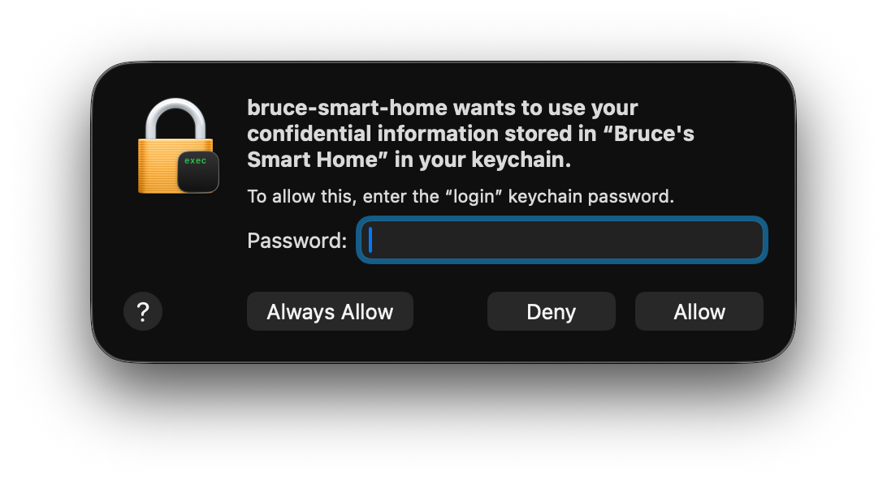

# Your Data
Bruce's Smart Home keeps what it has in two directories in your home directory, or in the data directory, see
[Profiles](profiles.md#moving-the-data-directory), kept apart so that your settings and secrets are never mixed with the
data, which may be large, copied or deleted:

- ```.bruce-smart-home```, your settings and secrets:
  - ```profiles.json```, your profiles, their settings, and the credentials of the data sources, see
    [Profiles](profiles.md).
  - ```tokens```, each profile's modules' sessions and refresh tokens, a file ```profile-module.json``` each. Reusing
    them avoids logging in each time, which data sources limit, so that you do not see "Too Many Requests" errors.
    They are sensitive: do not share them with anyone.

  The secrets in these, the API keys, passwords, login emails, capture devices' keys and tokens, are encrypted, see
  [Your secrets and the Keychain](#your-secrets-and-the-keychain).
  - ```node```, this installation's identity in the store, and ```window-state.json```, where the window was.
- ```.bruce-smart-home-data```, the data, which holds no secrets:
  - ```store```, each profile's data, a directory for each, named by its site's ID: everything fetched from the data
    sources, as they sent it, and what the capture devices took. Much of it, e.g. a capture device's snapshots or a
    source which only keeps a few weeks, can not be fetched again, so it is not a cache to delete lightly.
  - ```logs```, each profile's log, ```profile.log```.

Keeping a copy of what has been fetched makes the app faster, and reduces the load on the services it reads, most of
which limit how many requests can be made in a time.

## Your secrets and the Keychain
The logins Bruce's Smart Home keeps, e.g. your Octopus API key, your Tesla and myenergi passwords and the tokens it is
given when it logs in, are encrypted in its settings files, so that anyone who sees a copy of the files, e.g. in a
backup, or one shared by mistake, can not read them. The key which unlocks them is not in the files: it is kept in your
computer's own store of secrets, under "Bruce's Smart Home": the Keychain on macOS, the Credential Manager on Windows,
and the Secret Service (GNOME Keyring or KWallet) on Linux. The app makes the key the first time it saves a login, and
reads it once each time it starts, to read the logins.

On macOS the Keychain asks you whether the app may use the key, with a window like this:



Enter the password you log in to your Mac with, which is also your login keychain's password. It is macOS which asks
for it, not Bruce's Smart Home, which never sees it, and only gets the key. Then:

- **Always Allow** lets this version of the app read the key whenever it starts, without asking again.
- **Allow** lets it read the key this time only, so you are asked again the next time it starts.
- **Deny** stops it reading the key, so it can not read your logins, and shows an error saying it is unable to read
  the key of the secrets. Quit it, and start it again to be asked again.

The Keychain may ask the first time a new version of the app reads the key, e.g. after you install an update, as macOS
asks again for each app it does not recognise as the one which made the key. Choose **Always Allow** each time.

On Windows nothing is asked: the Credential Manager lets the programs you run read your credentials, so the key is
protected by your Windows login. On Linux, the Secret Service may ask you to unlock your keyring, if it is not unlocked
when you log in, or KWallet whether the app may use it.

As the key is kept on this computer only, the settings files can not be used on another one: copied to another
computer, the app there says that there is no key for the secrets, and you log in again there.

## The store
Each profile's data is kept in a store, [bruce-db](https://github.com/bruceskingle/bruce-db), which is designed to be
copied between the app and the capture devices, and later to a cloud database such as Amazon DynamoDB. Every record has
a ```Hash Key```, which names the set of data it is in, e.g. a meter's readings, and a ```Sort Key```, which orders it in
the set, e.g. a reading's time, and a version, the newest of which is the record. A profile's directory holds a
```journal``` of every record as it arrives, and, folded into them a day or so later, a directory for each set of data,
of files of its records in order of their sort keys, a file for each day of a series. Account and meter numbers are
replaced by hashes in the keys and the names of the files.

## Before version 0.5.0
The app was called Marco Sparko, and kept the profiles in ```.marco-sparko```, and everything else in a directory
```.marco-sparko-cache```. This version does not read them, so its profiles are set up afresh. You can delete those
files once you no longer need them.
